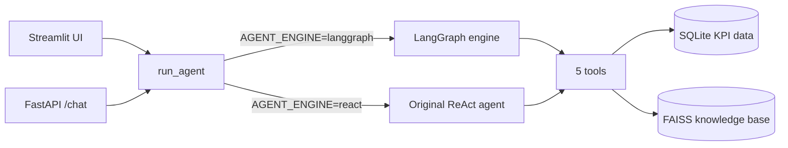
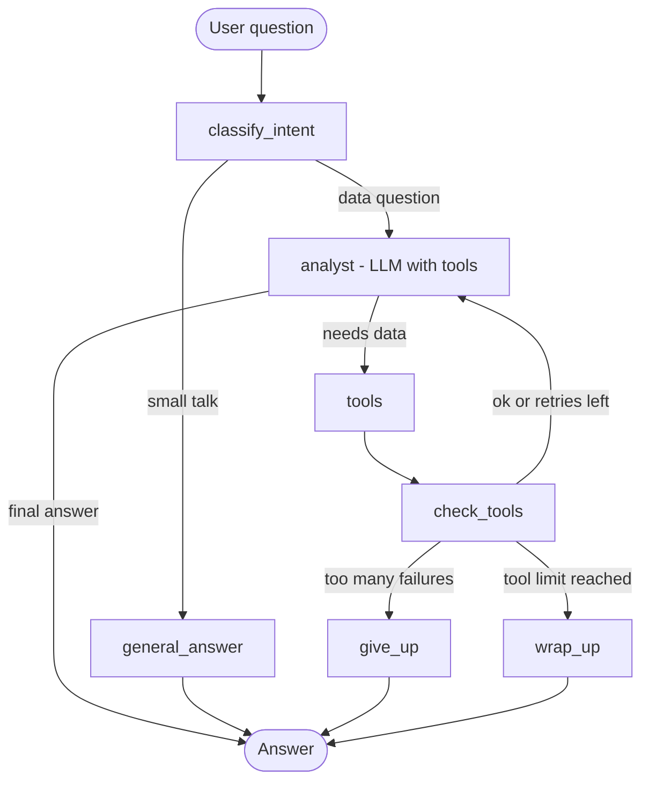

#  Call Center AI Analyst

> An AI agent that answers natural language
> questions about call center KPI performance — 
> built from hands-on experience with call center KPI reporting
> by a Data Analyst who works with this data every day.

It runs as a **Streamlit app** and a **FastAPI backend**, and supports two interchangeable agent engines:

- **LangGraph** (new): an explicit workflow with intent routing, bounded retries, safe fallbacks and per-session memory.
- **ReAct** (original): the first version, which parses the model's text output. Kept so the two can be compared.
  
#  Live Demo
 [**Try the app here**](https://call-center-chatbot.streamlit.app/)

# The Problem This Solves

Call center managers currently:
- Open Power BI dashboards manually
- Run multiple reports to identify issues
- Spend hours correlating data across agents and teams
- Need analyst support for every ad-hoc question
  
A manager who wants to know why an agent is underperforming must open dashboards, run queries, and cross-reference data manually.

**This system replaces that workflow — type a question, get a structured analysis in seconds.**

Manager types: "Why is Vikram underperforming?"

**The system answers** with figures taken from the database, for example:

| KPI | Vikram's average | Target | Gap vs target | Team A average | Gap vs team |
|---|---|---|---|---|---|
| AHT | 6.43 min | < 5.0 min | +1.43 min (28.5% above target) | 5.41 min | +1.01 min |
| FCR | 68.07% | > 80% | -11.93 pp (below target) | 75.12% | -7.05 pp |
| CSAT | 73.77% | > 85% | -11.23 pp (below target) | 80.42% | -6.65 pp |
| Adherence | 78.29% | > 90% | -11.71 pp (below target) | 85.85% | -7.55 pp |

"Vikram Nair's AHT of 6.43 min is 28% above team average.
 FCR has declined from 71% in Q1 to 65% in Q4 — a worsening trend.
 CSAT at 74% is 11 pts below target.
 Recommend immediate coaching on talk time management."

followed by suggested focus areas. The averages and gaps are computed by the tool, so the model quotes them and does not calculate them itself. The suggestions are the model's own and should be read as suggestions.

##  Why This Is An AGENT, Not Just RAG

Most AI chatbots just retrieve documents and answer.
This system **which tools to call** based on your question.

| Question Type | Tool Agent Chooses |
| "What is FCR?" | `search_knowledge_base` (RAG) |
| "Show Ravi's AHT" | `get_agent_metrics` (SQL) |
| "Team A vs Team B" | `get_team_comparison` (SQL) |
| "Who has worst CSAT?" | `get_top_bottom_agents` (SQL) |
| "Did FCR improve Q1→Q4?" | `calculate_metric_change` (SQL+Math) |
| "Why is this agent underperforming?" | ** several tools combined** |

The LLM reasons about which tools to call — this is the ReAct (Reason + Act) pattern.

The `tools_used` field in every response shows exactly which tools were called — full transparency.

# Architecture

```
User Question
      │
      ▼
Streamlit UI
      │
      ▼
FastAPI /chat endpoint
      │
      ▼
ReAct Agent (Groq Llama 3.3 70B)
"Which tool do I need?"
      │
  ┌───┴──────────────────────────────────────┐
  │                                            │
  ▼                                            ▼
SQL Tools                               RAG Tool
  get_agent_metrics()                   search_knowledge_base()
  get_team_comparison()                 FAISS Vector Store
  get_top_bottom_agents()               (monthly summaries +
  calculate_metric_change()              agent profiles +
                                         KPI definitions)
  │                                            │
  └───────────────┬───────────────────────────┘
                  ▼
         Agent synthesizes results
         Generates final analysis
                  │
                  ▼
         Response: answer + sources + tools_used

# RAGAS Evaluation Results

The RAG pipeline is validated using the [RAGAS framework](https://github.com/explodinggradients/ragas).

| Metric | Score | Meaning |
|---|---|---|
| **Faithfulness** | **1.000** ✅ | Zero hallucination — answers grounded in documents |
| **Answer Relevancy** | **0.961** ✅ | Answers directly address questions |
| **Context Precision** | **0.667** ⚠️ | Retrieval has room for improvement |
| **Overall** | **0.876** ✅ | Pipeline is reliable for production |

> Tested on 10 call center domain questions.
> Run evaluation: `python evaluate.py`

# Features

**5 Agent Tools:**
- `search_knowledge_base` — Semantic search on KPI docs and summaries
- `get_agent_metrics` — Real-time SQL query for any agent's KPIs
- `get_team_comparison` — Team A vs Team B aggregate comparison
- `get_top_bottom_agents` — Rankings and leaderboards by any KPI
- `calculate_metric_change` — Percentage change between any two periods

**Multi-turn Memory:**
- Conversation history per session using Python deque
- Follow-up questions reference previous answers
- Clear history endpoint to reset context

**Domain-Aware Logic:**
- KPI direction built into tools (AHT lower = better, FCR higher = better)
- Sort direction flips automatically based on metric type
- Target values baked into system prompt

# Tech Stack

| Component | Technology |
|---|---|
| UI | Streamlit |
| API | FastAPI |
| Agent Pattern | ReAct (LangChain) |
| LLM | Groq Llama 3.3 70B (Free) |
| Embeddings | HuggingFace all-MiniLM-L6-v2 (Local) |
| Vector Store | FAISS |
| Database | SQLite |
| Evaluation | RAGAS |

**Total API Cost: $0**

#Data

**10 Agents:**
- Team A (Mumbai): Ravi Sharma, Pooja Mehta, Vikram Nair, Rahul Joshi, Amit Gupta
- Team B (Bangalore): Arjun Kumar, Sneha Iyer, Divya Patel, Kavya Menon, Priya Reddy

**12 Months:** January 2024 — December 2024
**5 KPIs per agent per month:**

| KPI | Target | Direction |
| AHT (Average Handle Time) | < 5.0 min | Lower is better |
| FCR (First Call Resolution) | > 80% | Higher is better |
| CSAT (Customer Satisfaction) | > 85% | Higher is better |
| Adherence (Schedule) | > 90% | Higher is better |
| Calls Handled | — | Volume metric |

# Domain Expertise

This project was built by a Data Analyst with 2 years of hands-on experience working with real call center KPI data across enterprise clients.

The domain knowledge is embedded in tool logic:
- AHT direction (lower = better) → rankings sort ascending
- FCR/CSAT/Adherence (higher = better) → sort descending
- KPI targets are real industry benchmarks
- Analysis language matches operational reporting

## I've rebuilt ReAct & added LangGraph ##

## Architecture



Both the Streamlit app and the API call the same `run_agent()` function in `utils.py`. An environment variable chooses the engine. Both engines use the same tools, prompt, LLM and vector store.

### The five tools

| Tool | What it does |
|---|---|
| `search_knowledge_base` | Semantic search over KPI definitions and monthly reports (RAG) |
| `get_agent_metrics` | KPIs for one agent by month or quarter, with exact averages, team averages and gaps vs target and vs team |
| `get_team_comparison` | Team A vs Team B for a period |
| `get_top_bottom_agents` | Rankings by a KPI (it knows that for AHT lower is better) |
| `calculate_metric_change` | Change in a KPI between two periods for an agent or team |

### The LangGraph workflow



| Step | What happens |
|---|---|
| `classify_intent` | Keyword rules decide "data question" vs "small talk". The LLM is asked only when no keyword matches (this saves tokens). |
| `analyst` | The LLM decides which tools to call, using the model's native tool calling. If the model call itself fails, it retries once, then returns a clear message. |
| `tools` | Runs the chosen tools. A crashing tool becomes an error message instead of taking the app down. |
| `check_tools` | Looks at the results. Crashes and error-style replies (such as "Invalid metric") count as failures and are sent back to the model with the error text. |
| `give_up` | After 3 failed tries (1 attempt + 2 retries), stops with a clear message. |
| `wrap_up` | If the tool limit (6 rounds) is reached, the model writes an answer from the results it already collected. |
| `general_answer` | Replies to greetings and "what can you do?" without any tool. |

Other design choices:

- **Memory:** LangGraph's built-in checkpointer, one thread per `session_id`. Only the last 3 user turns are sent to the model. The ReAct engine keeps its original in-process history (a Python deque).
- **Safety limits:** max retries (2), max tool rounds (6) and a hard recursion limit, so a question can never loop forever.
- **Non-invasive switch:** `run_agent()` imports the LangGraph module only when `AGENT_ENGINE=langgraph`, so the original ReAct path is untouched.


## What changed and why

| # | Change | Why |
|---|---|---|
| 1 | **Added a LangGraph engine** (`langgraph_agent.py`) | The ReAct agent depends on the model writing exact `Thought / Action / Observation` text, and it stopped working reliably when the model changed (see 3). LangGraph uses native tool calling and gives explicit control over routing, retries, limits and fallbacks. |
| 2 | **Engine switch** (`AGENT_ENGINE`) in `run_agent()` | Lets both engines run on the same tools and data so they can be compared fairly. |
| 3 | **Replaced the Groq model** `llama-3.3-70b-versatile` with `openai/gpt-oss-120b` | Groq retired `llama-3.3-70b-versatile` on 16 August 2026 ([Groq deprecations](https://console.groq.com/docs/deprecations)), so every request returned a 404. The model name is now read from the `GROQ_MODEL` environment variable. |
| 4 | **Fixed three tool problems** (see [Bugs found and fixed](#bugs-found-and-fixed)) | The tools returned wrong or missing results in some cases. |
| 5 | **Moved calculations from the model into the tools** | The model was doing its own arithmetic on rounded numbers and sometimes mislabelled gaps. The tool now returns exact averages, team averages and gaps, and the model quotes them. |
| 6 | **Added prompt rules** | The model is told to quote tool gaps exactly, state only facts that appear in tool results, present explanations as possibilities, give no invented projections, refer only to data that exists in the database, and avoid HTML tags. |
| 7 | **One chat session per visitor** in the Streamlit app | Before, every visitor shared one session called `streamlit`. On a public app that means one person's questions became context for the next. |
| 8 | **Pinned dependencies** (`requirements.txt`) | An unpinned `langgraph` pulled in a newer `langchain-core` that broke `langchain-groq`. `langgraph==0.4.5` needs `pydantic>=2.7.4`, and `ragas==0.1.21` needs `langchain<0.3`, so versions have to be chosen together. |
| 9 | **Added comparison and verification scripts** | To measure the two engines and to check answers against the database instead of trusting them. |

## ReAct vs LangGraph

### Was LangGraph needed?

Not strictly. Much of the benefit comes from **native tool calling**, where the model returns a structured tool request instead of text that code must parse. A simpler tool-calling agent would also provide that. LangGraph adds explicit control around it: routing, bounded retries, limits and fallbacks, in a workflow that is easy to explain and debug.

### Differences

| | **Original ReAct agent** | **LangGraph agent** |
|---|---|---|
| How a tool is chosen | The model writes text; code parses the `Action:` line | The model returns a structured tool request |
| Who controls the flow | Mostly the model | The workflow: routes, limits and fallbacks are defined in code |
| Small talk | Goes through the full tool loop | Routed away from the tools |
| When a tool fails | Parsing errors or the iteration limit | The model sees the error and retries up to 2 times, then stops with a clear message |
| When it takes too many steps | Stops with an error-style message | Answers from the data it has already collected |
| Memory | Custom in-process history | Built-in, per session |
| Debugging | Long text logs | Named steps; the graph can be drawn |
| Depends on the model's exact text format | **Yes** | **No** |

### Advantages and limitations

**ReAct**
- Advantage: short, simple and easy to explain; works well when the model follows the format.
- Limitation: breaks when the model changes or does not follow the format exactly.
- Limitation: little control over failures, and retries cost tokens.

**LangGraph**
- Advantage: predictable behaviour with explicit limits, retries and fallbacks.
- Advantage: built-in memory, easy to extend, easier to debug.
- Limitation: more code and concepts (state, nodes, edges), about 300 lines versus a short function.
- Limitation: it does not make the model smarter, so explanations can still be wrong.
- Limitation: memory is held in the running process and is lost on restart, and the library's API changes between versions.

### Which is better?

For this project on `gpt-oss-120b`, LangGraph, because it does not depend on a text format the model may not follow. The comparison below measures it, with the caveats listed.

## Results

Both engines were run on the same 8 questions with the same model (`openai/gpt-oss-120b`), vector store and database, using `compare_engines.py`. "Right tool" means the answer used the tool expected for that question.

| Run | Metric | ReAct | LangGraph |
|---|---|---|---|
| **Run 1** (before the `get_team_comparison` fix) | Answered without error | 1 / 8 (12.5%) | 6 / 8 (75%) |
| | Used the expected tool | 1 / 8 | 8 / 8 |
| | Average seconds per question | 37.5 | 5.0 |
| **Run 2** (after the fix) | Answered without error | 0 / 8 | 8 / 8 |
| | Used the expected tool | 1 / 8 | 8 / 8 |
| | Average seconds per question | 34.9 | 8.6 (median 4.0) |

How to read this:

- **Why ReAct failed:** the failures were format and tool-call errors (for example "Tool choice is none, but model called a tool", malformed tool arguments and iteration limits). One ReAct failure in Run 2 was a Groq rate limit, not an agent problem.
- **The comparison favours LangGraph on this model.** The ReAct prompt was written for Llama 3.3, which no longer exists on Groq, and `gpt-oss-120b` does not follow that text format well. It shows ReAct is fragile when the model changes, not that it is worse in general.
- **Run 1's two LangGraph failures** came from a bug in an original tool (`get_team_comparison`), not from LangGraph.
- **"Answered" is not "correct".** The LangGraph answers in Run 2 were checked by hand against the database with `check_answers.py`: **5 of 8 were fully correct and 3 had errors.** The errors came from the model's own reasoning, not from the tool data. One answer said a team fell below a target it had stayed above (83.4% to 82.6% against an 80% target). One named the wrong month for an agent's highest AHT. One quoted slightly off averages and invented a cause that was not in the data.
- **Improvements made afterwards** (changes 5 and 6 above) addressed those errors. A spot check of the "Why is Vikram Nair underperforming?" answer afterwards matched the database for all four averages and all gaps. **The full 8-question comparison has not been re-run since those changes.**
- **Small test:** 8 questions, one run per engine, one model.

Raw data: `engine_comparison.json` and `engine_comparison.md`.

---

## Bugs found and fixed

Found while testing, all in the original tools and not in LangGraph:

1. **`get_team_comparison` crashed** with `'sqlite3.Row' object has no attribute 'get'`. It affected "Compare Team A vs Team B" and "why is X underperforming" questions. Fixed by converting each row with `dict(r)`.
2. **Team B questions returned Team A's numbers** in `calculate_metric_change`. The team was chosen with `"a" in name`, and the letter "a" appears in "Team B" too. Fixed to check for `"team b"`.
3. **`get_agent_metrics` returned only monthly rows rounded to one decimal.** The model then estimated full-year averages itself and was slightly off (for example AHT 6.6 instead of 6.43). The tool now returns exact averages, the team average over the same months, and gaps vs target and vs team, with explicit above/below wording.

---

## RAGAS evaluation

The retrieval and answer pipeline was validated with the [RAGAS framework](https://github.com/explodinggradients/ragas) on 10 call center questions.

| Metric | Score | Meaning |
|---|---|---|
| **Faithfulness** | **1.000** | Every claim in the 10 answers was supported by the retrieved documents |
| **Answer Relevancy** | **0.961** | Answers directly address the questions |
| **Context Precision** | **0.667** | Retrieval has room for improvement |
| **Overall** | **0.876** | |

Important notes:

- These scores were produced with the **earlier model (Llama 3.3)** as both answerer and judge. Re-run `python evaluate.py` with the current model before quoting them, and label new results with the model name.
- `evaluate.py` tests the **retrieval and answer part only**. It never calls the agent, so it cannot compare ReAct and LangGraph. That is what `compare_engines.py` is for.
- 10 questions is a small sample.

Run it with: `python evaluate.py`

---

## Features

**5 agent tools:** knowledge-base search, agent metrics, team comparison, rankings, and metric change (see above).

**Multi-turn memory:**
- LangGraph engine: built-in per-session memory, the last 3 user turns are used.
- ReAct engine: conversation history per session using a Python deque.
- In the Streamlit app every visitor gets their own session, and Clear Chat clears only theirs.

**Domain-aware logic:**
- KPI direction is built into the tools (AHT lower is better, FCR/CSAT/Adherence higher is better).
- Sort direction flips automatically with the metric.
- KPI targets are written into the system prompt.

### Tech stack

| Component | Technology |
|---|---|
| UI | Streamlit |
| API | FastAPI |
| Agent | LangGraph (new) and ReAct (original), via LangChain |
| LLM | Groq `openai/gpt-oss-120b` (free tier), configurable with `GROQ_MODEL` |
| Embeddings | HuggingFace `all-MiniLM-L6-v2` (local) |
| Vector store | FAISS |
| Database | SQLite |
| Evaluation | RAGAS and custom scripts |

**Total API cost: $0** on the free tiers.

### Data

**10 agents:**
- Team A (Mumbai): Ravi Sharma, Pooja Mehta, Vikram Nair, Rahul Joshi, Amit Gupta
- Team B (Bangalore): Arjun Kumar, Sneha Iyer, Divya Patel, Kavya Menon, Priya Reddy

**12 months:** January 2024 to December 2024.

| KPI | Target | Direction |
|---|---|---|
| AHT (Average Handle Time) | < 5.0 min | Lower is better |
| FCR (First Call Resolution) | > 80% | Higher is better |
| CSAT (Customer Satisfaction) | > 85% | Higher is better |
| Adherence (Schedule) | > 90% | Higher is better |
| Calls Handled | none | Volume metric |

### Domain expertise

The project was built by a data analyst with nearly 2 years of hands-on experience with call center KPI reporting across enterprise clients. That knowledge is embedded in the tool logic:

- AHT direction (lower is better) means rankings sort ascending
- FCR/CSAT/Adherence (higher is better) means sort descending
- The KPI targets are defined in the system prompt and the tools
- The analysis language follows operational reporting

## Run locally

```bash
# 1. Clone
git clone https://github.com/maahii6/cc-ai-analyst
cd cc-ai-analyst

# 2. Install (developed and run on Python 3.11)
pip install -r requirements.txt

# 3. Add your API key (never commit this file)
echo "GROQ_API_KEY=your_key_here" > .env
# optional: GROQ_MODEL=openai/gpt-oss-120b

# 4. The database and vector store are included.
#    Run setup only if they are missing:
python setup_data.py
```

Choose the engine with `AGENT_ENGINE` (`langgraph` or `react`). If it is not set, the original ReAct path runs.

```powershell
# Windows PowerShell
$env:AGENT_ENGINE="langgraph"
streamlit run streamlit_app.py
```
```bash
# macOS / Linux
AGENT_ENGINE=langgraph streamlit run streamlit_app.py
```

API backend (port 8001, docs at `http://localhost:8001/docs`):

```powershell
$env:AGENT_ENGINE="langgraph"
python main.py
```

The Streamlit app runs the agent itself and does not call the API.

## Deploy on Streamlit Community Cloud

1. Push the repo to GitHub. Commit the database and the `vectorstore_cc/` folder. **Never commit `.env`.**
2. The dependency file must be called `requirements.txt`.
3. In the app's **Advanced settings**, choose Python 3.11 (the version the pinned packages were tested with) and paste your secrets in TOML format:

```toml
GROQ_API_KEY = "your_key_here"
GROQ_MODEL = "openai/gpt-oss-120b"
AGENT_ENGINE = "langgraph"
```

Top-level string secrets are also available to the app as environment variables, which is how the code reads them.

4. Use a separate Groq key for each deployed app, so one demo cannot use up the other's free-tier limit.
5. The Streamlit app currently uses one shared chat session for every visitor. For a public deployment, give each visitor their own `session_id` (for example with `st.session_state`).

## API

| Method | Endpoint | Description |
|---|---|---|
| POST | `/chat` | Ask a question. Body: `{"question": "...", "session_id": "..."}`. Returns `answer`, `sources`, `session_id`, `tools_used`. |
| POST | `/clear_history` | Clear the memory for a session. |
| GET | `/agents` | List all agents. |
| GET | `/health` | Health check. |

Use a different `session_id` for each user or chat.

## Project structure

```
cc-ai-analyst/
├── main.py                  FastAPI endpoints
├── utils.py                 5 agent tools, the ReAct agent, and run_agent() with the engine switch
├── langgraph_agent.py       LangGraph engine
├── setup_data.py            Database and vector store creation
├── schemas.py               Pydantic models
├── evaluate.py              RAGAS evaluation (retrieval and answers)
├── compare_engines.py       Runs the same questions through both engines
├── check_answers.py         Prints ground-truth numbers from the database
├── streamlit_app.py         Streamlit UI
├── requirements.txt
├── cc_database.db           SQLite (600+ data points)
├── vectorstore_cc/          FAISS index
├── engine_comparison.md     Comparison results (readable)
├── engine_comparison.json   Comparison results (raw)
├── evaluation_results.json  RAGAS detailed results
├── evaluation_summary.txt   RAGAS summary
└── screenshots/             Demo screenshots
```

## Evaluation and verification scripts

| Script | What it does | What it does not do |
|---|---|---|
| `compare_engines.py` | Runs 8 questions through both engines and records success, whether the expected tool was used, time and tool calls. Writes `engine_comparison.md` and `.json` with every answer side by side and a blank "Correct?" column. | It does not judge whether the numbers in an answer are correct. |
| `check_answers.py` | Reads `cc_database.db` with plain SQL (no AI, no agent tools) and prints the true numbers so each answer can be marked correct or wrong. Read-only. | It prints the claims from specific past answers, so update its "agent said" lines for new runs. |
| `evaluate.py` | RAGAS metrics for the retrieval and answer part. | It never calls the agent. |

```bash
python compare_engines.py
```

| Variable | Effect |
|---|---|
| `COMPARE_ENGINES=langgraph` | Run only LangGraph and reuse the saved ReAct results from the last `engine_comparison.json`. Saves tokens. |
| `COMPARE_PAUSE=15` | Seconds to wait between runs (Groq free-tier limits). |
| `COMPARE_RATE_WAIT=65` | Seconds to wait before retrying once after a rate limit. |

## Known limitations

- **The model's written explanations can still be wrong.** The numbers come from tools and are exact, but the model's interpretation (comparisons, causes, recommendations) is not guaranteed. The tool changes and prompt rules reduce this; they do not remove it. Treat explanations as suggestions, and check important numbers.
- **The comparison is small:** 8 questions, one run each, one model, and measured before the latest tool and prompt improvements.
- **The ReAct baseline is not tuned for the current model.** Its prompt was written for Llama 3.3.
- **Memory is in-process.** It is lost when the server restarts. The Streamlit app also uses a single shared session, so it is built for one user at a time.
- **Groq free-tier limits.** Questions that need several tool calls can hit per-minute or per-day token limits (HTTP 429).
- **Fixed scope.** The data covers 10 agents, 2 teams and one year. The tools and prompt are written for those KPIs and targets.
- **Demo-level security:** CORS allows all origins, there is no authentication, one tool puts the metric name into its SQL string (it should be restricted to a whitelist), and the FAISS index is loaded with deserialization enabled (safe only for indexes you built yourself).
- **RAGAS scores** were produced with an earlier model configuration.

## Lessons learned

1. **Depending on a text format is fragile.** When the model changed, the ReAct parser failed almost every time. Native tool calling removed that dependency.
2. **Let code do the arithmetic.** When the model computed gaps itself, it mislabelled them. Returning exact values from the tool fixed it at the source.
3. **"It answered" is not "it's right".** Checking answers against the database found errors that success rates alone hid.
4. **Test your own tools.** The biggest real bugs (a crash, and Team B returning Team A's data) were in the tools, not in the agent engine.
5. **Do not depend on a single model name.** The model retirement broke the app. Reading the name from an environment variable turns the next one into a one-line change.
6. **Pin dependencies together.** One unpinned package broke a working environment.
7. **A shared session id is a bug on a public app.** Every visitor needs their own.

## Example questions

**Performance**
- "Why is Vikram Nair underperforming?"
- "Show Kavya Menon full 2024 performance"
- "Which agents are below FCR target?"

**Comparisons**
- "Compare Team A vs Team B for full year"
- "Which team has better adherence in Q3?"

**Rankings**
- "Who are top 3 agents by CSAT?"
- "Which agents need coaching most urgently?"

**Trends**
- "How did FCR change from Q1 to Q4?"
- "Which KPI declined most in Q4?"

**Definitions**
- "What is AHT and why does it matter?"
- "What are the KPI targets?"


